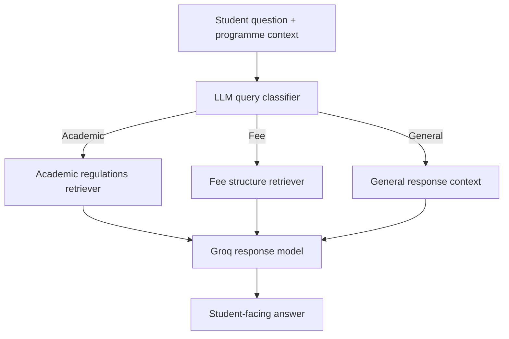

# College Assistant

A Streamlit-based student knowledge assistant for asking questions about BITS Pilani programmes, academic rules, and fee information. It routes each query to the relevant official-document retrieval path or to a general conversational response.

The current source code loads the academic regulations and fee structure PDFs from the repository root, indexes their contents with FAISS, and uses a LangGraph workflow to classify and answer questions.

## Features

- Select a study level (UG, PG, or PhD) and a specific programme.
- Ask about academic regulations, degree requirements, attendance, examinations, grading, credits, fees, payments, refunds, late charges, and scholarships.
- Route academic questions to the academic regulations index.
- Route financial questions to the fee structure index.
- Handle general questions with a direct LLM response.
- Maintain chat history for the current Streamlit session.
- Use suggested questions to get started.

## Workflow



### Retrieval pipeline

For each PDF source, the application:

1. Loads pages with `PyPDFLoader`.
2. Splits document text into chunks of 800 characters with 100-character overlap.
3. Creates embeddings with Cloudflare Workers AI using `@cf/baai/bge-m3`.
4. Stores vectors in a FAISS vector store and exposes a retriever configured to return up to four relevant chunks.

The query classifier selects one of three routes: `academic`, `fee`, or `general`. Retrieval-based answers are instructed to use the official-document excerpts as the primary source and state when the retrieved context cannot verify an answer.

## Tech Stack

- **Python**
- **Streamlit** — user interface
- **LangGraph** — query classification and conditional routing
- **LangChain** — document loading, text splitting, model and retrieval integrations
- **Groq** — `openai/gpt-oss-120b` response and classification model
- **Cloudflare Workers AI** — BGE-M3 embeddings (`@cf/baai/bge-m3`)
- **FAISS** — vector similarity search
- **PyPDF** — PDF document loading
- **python-dotenv** — environment variables

## Source documents

The current code expects these two files in the project root:

- `Academic-Regulations-2023.pdf`
- `Fee_Structure_AY_2026-27.pdf`

These names are referenced directly in `project.py`. Keep the PDFs in the root directory or update the paths in code before running the app. Use the latest official documents when maintaining a live student information service.

## Project structure

```text
College_assistant/
├── app.py
├── project.py
├── requirements.txt
├── Academic-Regulations-2023.pdf
└── Fee_Structure_AY_2026-27.pdf
```

## Getting started

### Requirements

- Python 3.10+
- Groq API key
- Cloudflare account ID and Workers AI API token

### 1. Clone the repository

```bash
git clone https://github.com/srini526/College_assistant.git
cd College_assistant
```

### 2. Create a virtual environment and install dependencies

```bash
python -m venv .venv
```

**Windows PowerShell**
```powershell
.\.venv\Scripts\Activate.ps1
```

**macOS / Linux**
```bash
source .venv/bin/activate
```

Install:

```bash
pip install -r requirements.txt
```

### 3. Configure API credentials

Create a root `.env` file:

```env
GROQ_API_KEY=your_groq_api_key
CLOUDFLARE_ACCOUNT_ID=your_cloudflare_account_id
CLOUDFLARE_API_TOKEN=your_cloudflare_workers_ai_token
```

Confirm that the Cloudflare token has the required Workers AI permissions. Keep the `.env` file private and out of Git.

### 4. Run the application

```bash
streamlit run app.py
```

Open the local Streamlit URL. Select a programme and ask a question.

## Important limitations

- This is a document-grounded prototype, not an official BITS Pilani service.
- Accuracy depends on the contents, freshness, and completeness of the two PDF documents.
- The current classifier is an LLM routing step; it is not a separately trained intent classifier.
- General questions are answered from the model's own knowledge and are not grounded in the two PDFs.
- The current project code loads both source PDFs at startup, so missing files or invalid paths prevent initialization.
- Chat history is stored in Streamlit session state and is not a persistent account history.

Verify important admission, academic, and fee decisions against official BITS Pilani sources.

---

Built to explore document-based question answering, vector retrieval, and conditional LangGraph routing.
